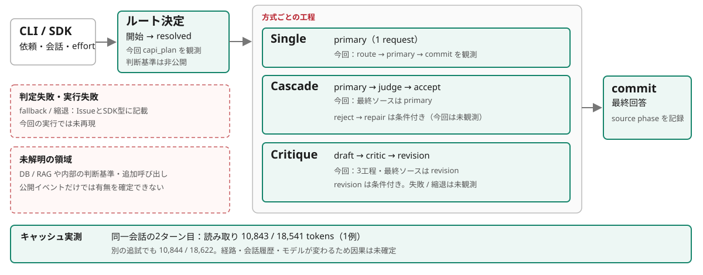
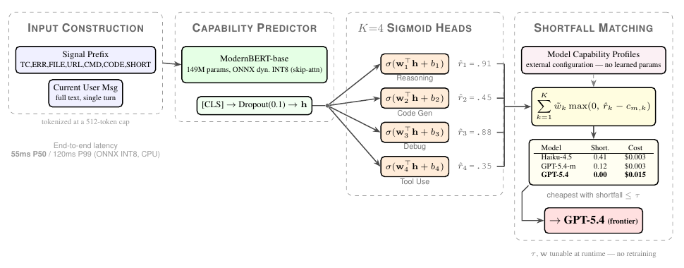
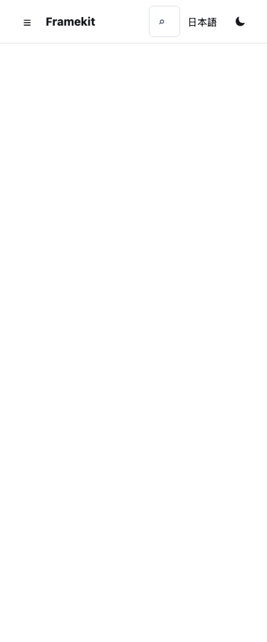
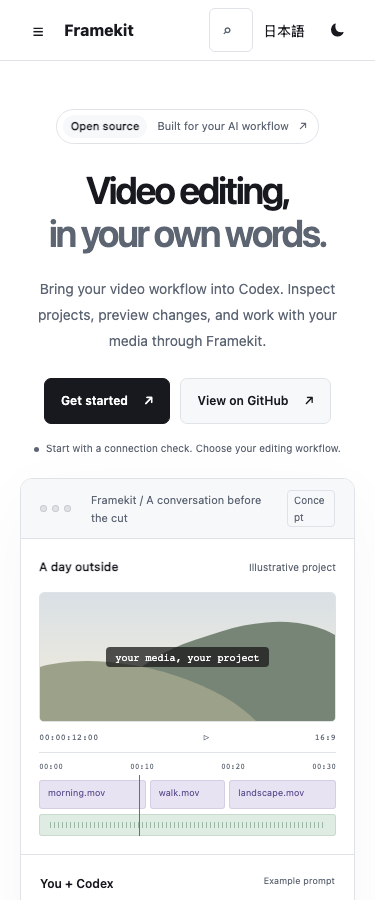
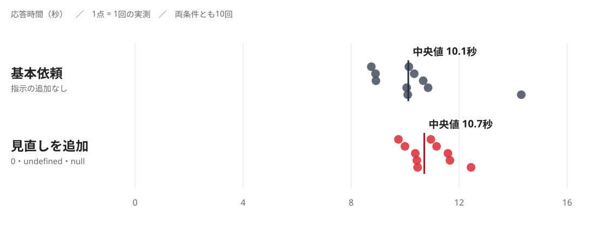
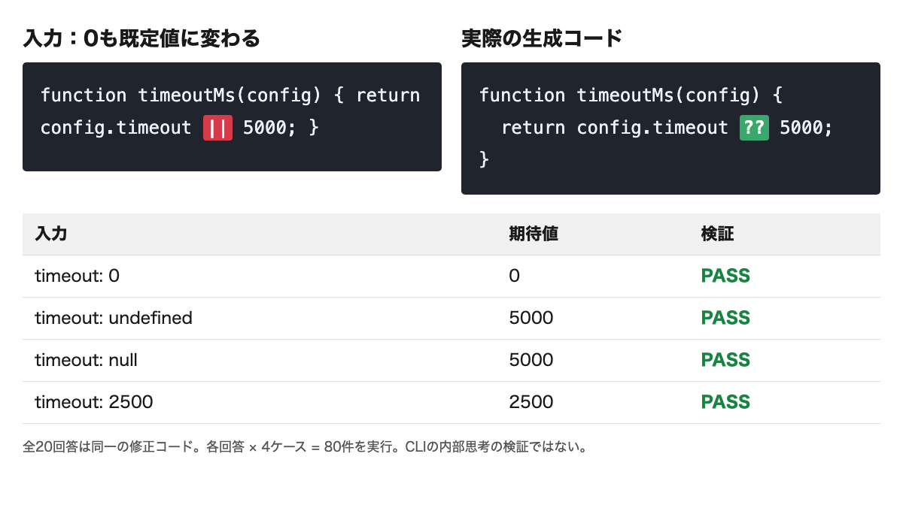

<!-- _class: cover -->

# Copilot Fusion

使い倒してわかった、 モデル選択の裏側と実践のヒント

GITHUB UNIVERSE RECAP 2026 ROUTING　/　AGENTS　/　EVIDENCE

---

## 自己紹介

---

<!-- _class: deck -->

## Copilot Fusion とは？

  選ぶのは<strong>単一のモデル</strong>ではなく、<strong>モデルと処理の組み合わせ</strong>

  

    <h3>利用者が決める</h3>
    
タスクと <b>effort</b> Standard / High / Max

  

  
→

  

    <h3>Fusion が決める</h3>
    
利用可能なモデルと <b>Single / Cascade / Critique</b>

  

  
→

  

    <h3>受け取る</h3>
    
統合された <b>ひとつの回答</b>

  

  出典: GitHub Docs “About GitHub Copilot Fusion” · モデルプールと挙動は変わる可能性があります

---

<!-- _class: deck -->

## Fusion の中で何が起きる？

<strong>経路の予定・実行・最終回答</strong>をイベントで照合する

  緑：今回の観測 · 点線：未確認 · SDK 2.0.1 / High · 各経路は別試行 · 2026-11-26

---

<!-- _class: deck -->

## キャッシュはどれくらい使われた？

  同じ長い依頼の2試行で、<strong>2ターン目に約1.08万トークンを再利用</strong>

<table class="comparison cache-table">
  <thead>
    <tr>
      <th>実行条件</th>
      <th>cache read / input</th>
      <th>追試</th>
    </tr>
  </thead>
  <tbody>
    <tr>
      <td>同一会話の2ターン目</td>
      <td><b>10,843 / 18,541</b></td>
      <td><b>10,844 / 18,622</b></td>
    </tr>
    <tr>
      <td>新規セッションで同じ依頼</td>
      <td>1,271 / 10,848</td>
      <td>1,271 / 10,843</td>
    </tr>
    <tr>
      <td>同一会話で課題を変更</td>
      <td>0 / 35,823</td>
      <td>1,271 / 35,932</td>
    </tr>
  </tbody>
</table>

  課題変更時は会話履歴・モデル・経路も変化。 何がキャッシュ差の原因かは、この比較だけでは分からない。

  SDKのfusion_completedが報告した入力・キャッシュ読み取り · High · 各2試行 · 2026-11-26

---

<!-- _class: deck -->

## モデルをどう選ぶ？ HyDRA 論文

  要求を4つの能力として推定し、<strong>モデルの不足分</strong>を比較する

  

  <b>図中の 0〜1：</b>要求の強さを表す推定スコア。 例は論文中の「WebSocket再接続の競合を修正」

  Garg et al., HyDRA, EMNLP 2026, Figure 1, p.1379 ·
  https://aclanthology.org/2026.emnlp-industry.82/ ·
  関連するAuto選択の研究で、Fusion全体の実装仕様ではありません

---

<!-- _class: deck -->

## 観測：Cascade で実際に動いた工程

短い修正課題の20試行はすべて <strong>primary → judge</strong> の2工程

  

    <small>入力</small><b>JavaScript の修正依頼</b>
  

  →
  

    <small>primary / solver</small><b>gpt-6.1-sol</b>
    
候補を生成

  

  →
  

    <small>judge</small><b>gpt-6-luna</b>
    
候補を評価

  

  →
  
<small>出力</small><b>最終回答</b>

  20 / 20 試行で各2リクエスト。<b>repair の開始イベントは0 / 20</b
  >。 これらは実行イベントの観測であり、経路選択の理由や内部の評価基準は不明。

  Copilot SDK 2.0.1 · Fusion High · 同一課題、指示2条件を各10回 · ツール無効 · 2026-11-26

---

<!-- _class: deck -->

## よく使う基本コマンド

利用前に<strong>モデル・利用量・コンテキスト</strong>を確認

  

    <code>/model</code><strong>Fusion と effort を選択</strong
    >利用可能なモデルはプランやポリシーに依存
  

  

    <code>/usage</code><strong>利用量の確認</strong>表示された利用量と実請求額は異なる
  

  

    <code>/context</code><strong>コンテキストの状態</strong
    >開始直後は情報が表示されないことがある
  

  Copilot CLI 1.0.115で確認 · コマンドや利用条件はバージョンによって変わります

---

<!-- _class: deck -->

## 知っておきたいコマンド

並列調査、設定確認、独立レビューを<strong>短い操作</strong>で

  

    <code>/fleet</code><strong>独立した作業を並列委任</strong
    >CLIの --fleet 追試では3 / 5回で開始・完了
  

  

    <code>/env</code><strong>instructions・agents 等を確認</strong
    >意図した設定が読み込まれているかを見る
  

  

    <code>/rubber-duck</code><strong>別の視点から設計を批評</strong
    >セカンドオピニオンを依頼 · 今回は未実行
  

  GitHub Copilot CLI command reference · /fleetとFusionのCritiqueは別機能 · --fleet追試 n=5

---

<!-- _class: deck -->

## デモ：Fusion の経路をイベントで追う

別のSDK実行で <strong>予定 → 開始・完了 → 最終ソース</strong> を照合

  

    <small>予定: Cascade</small><b>primary → judge</b>
    
repair は条件付き

  

  →
  

    <small>開始 → 完了</small><b>gpt-6.1-sol</b>
    
primary / solver

  

  →
  

    <small>開始 → 完了</small><b>gpt-6-luna</b>
    
judge / accept

  

  →
  

    <small>完了</small><b>primary</b>
    
最終ソース · 2 requests

  

  repair の開始は未観測。予定を実行済みとは扱わない。 次の Framekit 開発録画とは別セッション。

  SDK 2.0.1 / High · 同一会話の課題変更ターン1件 · fusion-runtime-study-2026-11-26.json

---

<!-- _class: deck -->

## デモ：Framekit の Red → Green

  Framekit の<strong>同一セッション</strong>で、各依頼の経路とテスト結果を照合

  

    <h3>Red：Cascade</h3>
    
gpt-6.1-sol → gpt-6-luna

    <small>primary → judge 完了・accept。後のテストで通常モーションは opacity 0、2件失敗。</small>
  

  

    <h3>Green：Critique</h3>
    
Opus 5.5 → Luna → Opus 5.5

    <small>draft → critic → revision 完了。その後の修正検証で20ケース通過。</small>
  

  途中で利用上限に達し、上限変更後に再開。開始イベントは保存記録にない。 モデルの完了順と後続のツール実行を区別する。

CLI 1.0.115 · 2026-11-25 · 保存ログの本文・IDを除いた集計と開発記録

---

<!-- _class: deck -->

## 実際の開発：初期表示の修正

Fusionに依頼し、<strong>修正前後の初期フレーム</strong>を確認

  
<b>修正前</b>

  
<b>修正後</b>

  <aside>
    <strong>表示開始時から 文字とボタンを表示</strong>
    
テスト先行で修正。 20ケースを実行。

  </aside>

  ローカル生成物 · Chromium / light / 375px · 初期アニメーションを停止して比較

---

<!-- _class: deck -->

## Tip：Issue の条件を PR の検証へ

  Fusion がモデルを選び、<strong>メンテナーが合格条件と根拠を残す</strong>

  

    <h3>Issue #796：合格条件</h3>
    
初期表示で <b>図の文字が見える</b>

    <small>見出し・説明・CTA に加え、図も確認対象にする。</small>
  

  

    <h3>PR に書く検証結果の例</h3>
    
hero のテスト：<b>20ケース通過</b> 図の文字：<b>未検証</b>

    <small>対象外を明記し、図の検証を追加してから判定する。</small>
  

  Framekit #796 のローカル開発記録 · PR記載の例であり、Framekit側のPRは未作成

---

<!-- _class: deck -->

## Tip 1：subagent は本当に起動した？

同じ読み取り専用課題に、<strong>3つの方法で委任</strong>

  

    <b>全条件の依頼</b> sample.ts を読み、timeoutMs
    のバグと修正案を報告してください。変更や外部アクセスはしないでください。
  

  

    <b>プロンプト条件の追加文</b> <mark>subagentにファイルの調査を委任してください。</mark>
  

  

    <b>AGENTS.md 条件</b> <small
      >When investigating sample.ts, delegate the initial file investigation to the explore subagent
      and use its findings. Do not modify files or access the network.</small
    >
  

  

    <b>CLI オプション条件</b> <code>copilot --fleet ...</code> <small
      >共通の依頼を渡す</small
    >
  

実際の追試の指示 · experiments/data/subagent-followup-2026-11-26.json

---

<!-- _class: deck -->

## Tip 1：開始・完了を確かめる

  CLI は<strong>作業を委任</strong>、Fusion は<strong>モデルと処理経路を選択</strong>

<table class="comparison delegation-results">
  <thead>
    <tr>
      <th>追試の条件</th>
      <th>開始した試行</th>
      <th>完了した試行</th>
      <th>開始 / 完了イベント</th>
    </tr>
  </thead>
  <tbody>
    <tr>
      <td>プロンプトで委任</td>
      <td>5 / 5</td>
      <td>5 / 5</td>
      <td>5 / 5</td>
    </tr>
    <tr>
      <td>AGENTS.md で委任</td>
      <td>5 / 5</td>
      <td>5 / 5</td>
      <td>5 / 5</td>
    </tr>
    <tr>
      <td>--fleet</td>
      <td>3 / 5</td>
      <td>3 / 5</td>
      <td>9 / 9</td>
    </tr>
  </tbody>
</table>

  <b>次の Issue で：</b>「初期調査を subagent
  に委任し、原因・修正案・根拠の行を報告。変更と外部アクセスは禁止。結果を回答に取り込んで」

  CLI 1.0.115 / Fusion High · 各5試行・4並行 · view, task のみ · AGENTS.md 条件のみ指示読込有効 1試行で複数イベントあり
  · 1課題の観測であり、一般的な成功率ではない

---

<!-- _class: deck -->

## Tip 2：見直し指示と応答時間

同じ課題で各10回。<strong>「3ケースを1回見直す」</strong>指示を追加

  

  両条件ともCascade 10/10（各2 requests） · モデルのみ・ツール無効 · 因果効果は未確定

---

<!-- _class: deck -->

## 見直し指示：実際に渡したプロンプト

基本依頼に<strong>1文だけ追加</strong>して比較

  <h3>両条件に共通</h3>
  

    次の JavaScript
    関数はゼロも有効な設定値として扱う必要があります。バグを指摘し、修正済みの関数を返してください。
  

  <pre>function timeoutMs(config) { return config.timeout || 5000; }</pre>
  
例: timeoutMs({timeout: 0}) は 0 を返します。

  <h3>見直し条件だけに追加</h3>
  
<mark>回答前に、0・undefined・null の3ケースを1回見直してから結論を返してください。</mark>

  SDK / Fusion High · 各10回 ·
  ツール無効。内部の思考回数やエージェントのツールループは測定していません

---

<!-- _class: deck -->

## 生成コードを、実際にテストする

20回答すべて同じ修正。<strong>入力4ケース × 20回答が通過</strong>

  

  各回答のコードを抽出し、こちらでNode.js上で実行 · 80 / 80合格 · モデル自身によるテスト実行ではない

---

<!-- _class: deck -->

## Tip 3：必要な品質を満たした？

品質条件：<strong>初期表示から図の文字まで</strong>確認する

  

    <h3>成果物 A</h3>
    
見出し・説明・両CTA・図の文字

    <small>初期から3秒、light / dark で確認するテスト案</small>
  

  

    <h3>成果物 B</h3>
    
見出し・CTA を確認

    <small>図の文字はテストの測定対象に含まれない</small>
  

  同じIssue本文から得た<strong>テスト案</strong>。どちらが品質条件を満たす？

  各1試行 · Framekit Issue #796 · テスト案は未実行 · experiments/effort-quality-observation.md

---

<!-- _class: deck -->

## 成果物の設定と利用量を開示

この1例では<strong>利用量が少ない案に確認漏れ</strong>があった

<table class="comparison cost-table">
  <thead>
    <tr>
      <th></th>
      <th>成果物 A</th>
      <th>成果物 B</th>
    </tr>
  </thead>
  <tbody>
    <tr>
      <td>設定</td>
      <td>High 優先</td>
      <td>Max 単独</td>
    </tr>
    <tr>
      <td>品質条件</td>
      <td class="ok">合格</td>
      <td class="ng">図の文字が抜けて不合格</td>
    </tr>
    <tr>
      <td>利用量</td>
      <td><b>34.426 AI credits</b></td>
      <td><b>30.113 AI credits</b></td>
    </tr>
  </tbody>
</table>

  同じIssue・合格条件で、プロンプトかeffortを<strong>一つずつ</strong>変えて試す。

  各1試行 · テスト案の比較 · AI credits は請求額ではない · 品質が異なるため単純な費用比較はできない

---

<!-- _class: deck -->

## まとめ
