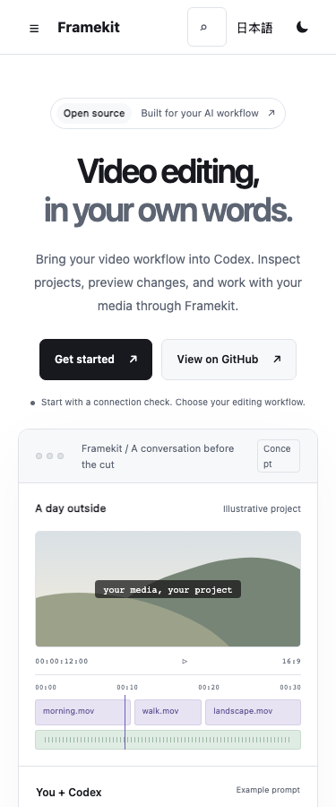

<!-- _class: cover -->

# Copilot Fusion

使い倒してわかった、 モデル選択の裏側と 実践のヒント

GitHub Universe Recap 2026 Routing / Agents / Evidence

---

<!-- _class: chapter -->

## 01. Copilot Fusion

モデルと処理をどう選ぶ？

---

<!-- _class: flow -->

Copilot Fusion / model routing

## 単一のモデルではなく、 モデルと処理の組み合わせ

|     利用者      |           Fusion            |      回答      |
| :-------------: | :-------------------------: | :------------: |
| タスクと effort | Single / Cascade / Critique | 統合された結果 |

出典: GitHub Docs “About GitHub Copilot Fusion” · モデルプールと挙動は変わる可能性があります

---

<!-- _class: chart -->

SDK / Fusion High / 各2試行

## 同一会話の2ターン目に 約1.08万トークンを再利用

| 実行条件            | cache read（初回） |   追試 |
| :------------------ | -----------------: | -----: |
| 同一会話の2ターン目 |             10,843 | 10,844 |
| 新規セッション      |              1,271 |  1,271 |
| 同一会話で課題変更  |                  0 |  1,271 |

cache read トークン数。課題変更時は会話履歴・モデル・経路も変化し、差の原因は不明。

SDK の fusion_completed が報告したキャッシュ読み取り · 2026-11-26

---

<!-- _class: commands -->

Copilot CLI / commands

## 利用前に確認する

| コマンド   | 用途               | 補足                                   |
| :--------- | :----------------- | :------------------------------------- |
| `/model`   | モデルを選択       | Fusion と effort を選ぶ                |
| `/usage`   | 利用量を確認       | 表示された利用量と実請求額は異なる     |
| `/context` | コンテキストを確認 | 開始直後は情報が表示されないことがある |

Copilot CLI 1.0.115で確認 · コマンドや利用条件はバージョンによって変わります

---

<!-- _class: demo -->

Framekit / 実際の開発

## 初期表示を修正する

FRAMEKIT / #796

初期フレームから 文字とボタンを表示。

テスト先行で修正。 **20ケース通過。**

ローカル生成物 · Chromium / light / 375px · 初期アニメーションを停止して比較

---

<!-- _class: chapter -->

## 02. 実践のヒント

観測、検証、比較

---

<!-- _class: takeaways -->

Takeaways

## Fusion を使うときの視点

1. 予定・実行・最終回答を区別する
2. 生成されたコードを実際に検証する
3. 利用量と成果物の差を一緒に見る

本編の観測・実践を整理した見本スライド
