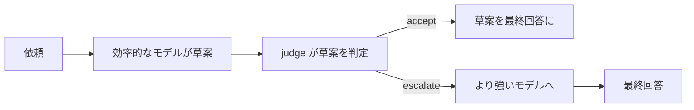
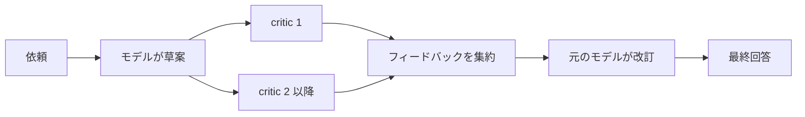

# Fusion のモデル選択と実行経路：根拠の整理

調査日: 2026-11-26。スライド統合のための資料。ラベルは **公開仕様**、**関連研究**、**実測**、**仮説・未確認** を表す。論文の Auto 実装と現在の Fusion 内部を同一視しない。新規リクエストは実行していない。

## 選択の判断材料

**公開仕様:** [Fusion 公式説明](https://docs.github.com/en/copilot/concepts/models/copilot-fusion#how-copilot-fusion-works) は、推論・コード生成・デバッグ・ツール使用の能力シグナルと課題、選択した effort に応じた品質基準から方式を選ぶと説明する。モデルと reasoning effort は工程ごとに設定され、利用候補はプラン・ポリシーにも制約される。スコアの算出、重み、閾値、個別のモデルや方式が選ばれる条件は公開されていない。

**関連研究:** [HyDRA 論文 §3](https://arxiv.org/html/2605.17106#S3) は VS Code Chat の Auto 向けに、現在のメッセージと7種のフラグから上記4軸の要求値を予測し、設定されたモデル能力と照合する方式を記述する。各軸の不足を重み付きで合計し、閾値以下の候補から低コストのモデルを選ぶ。該当候補がない場合は不足が最小の候補にフォールバックする。1軸の過剰な能力で他軸の不足を相殺しない。これは論文中の設計であり、Fusion の現在の閾値や経路選択アルゴリズムの証拠ではない。

**実測:** SDK 2.0.1 の探索16ターンでは4軸の scores と方式を取得した。異なる題材での確認では説明 2/24、設計 5/24 が複数工程だった。小標本で差の不確実性が大きく、スコアが選択の原因という証拠ではない。[プロトコル・集計・限界](fusion-hypotheses-2026-11-26.md)。

## 負荷・キャッシュ・effort

| 材料 | 公開根拠 / 実測 | 仮説・未確認 |
| --- | --- | --- |
| 負荷 | **公開仕様:** [Fusion 公式説明](https://docs.github.com/en/copilot/concepts/models/copilot-fusion#overview) はモデル選択時にリアルタイムのシステム健全性と可用性を考慮すると説明する。**関連研究:** [HyDRA §8・付録 C](https://arxiv.org/html/2605.17106#S8) は throughput、エラー率、遅延による health veto を記述する。候補の順位変更ではなく不健全な候補の除外で、全候補が除外された場合はフォールバックする。 | 現在の Fusion で論文と同じ veto、指標、閾値が適用されるかは未確認。負荷が観測された方式を決めたとは言えない。 |
| キャッシュ | **公開仕様:** [Fusion 公式説明](https://docs.github.com/en/copilot/concepts/models/copilot-fusion#overview) は、自然なキャッシュ境界や会話の複雑さが大きく変化する際にルーティングすると説明する。[課金の説明](https://docs.github.com/en/copilot/concepts/models/copilot-fusion#billing-for-copilot-fusion) では、キャッシュを生かすため主会話のモデルを可能な限り維持するとしている。**関連研究:** 論文の Auto はセッション内でモデルを維持し、初回や圧縮後に再選択する設計を記述する。**実測:** 継続会話で cache read が増えた一方、別の変更後に減った例がある。[条件と数値](fusion-runtime-architecture.md#実験条件と結果)。 | 論文の具体的な sticky routing が Fusion に適用されるか、キャッシュ境界の定義や再利用条件は不明。会話・課題・モデル・方式が同時に変わったため因果は不明。Fusion 公式説明は同一セッションでもプロンプトごとに方式が変わり得るとする。 |
| effort | **公開仕様:** [公式説明](https://docs.github.com/en/copilot/concepts/models/copilot-fusion#copilot-fusion-effort-levels) では Standard は各課題で1モデル、High は必要に応じ追加呼び出し、Max は高度な能力を優先する。**実測:** 同じ課題の High 1回が Critique、Max 1回が Single だった。[条件](fusion-runtime-architecture.md#critique分岐失敗時はどうなるか)。 | 時刻なども異なり、effort が差の原因とは断定できない。High / Max の方式や費用を個々の実行について保証しない。 |

## 方式別の論理フロー

以下は [公式仕様](https://docs.github.com/en/copilot/concepts/models/copilot-fusion#how-copilot-fusion-works) を図示したもの。分岐条件の詳細は非公開。図は物理構成や全失敗経路を表さない。

### Single

**実測:** 単純課題で primary 1工程・concrete model request 1回、最終ソース primary を観測。ルーター内の呼び出しの有無は分からない。[実行記録](fusion-runtime-architecture.md#single1モデルだけで全処理が終わるのか)。

### Cascade

**実測:** primary → judge の2件はいずれも accept で最終ソースは primary。reject / repair は第三者報告があるが今回未観測。judge の基準や参照範囲は不明。[実行記録と第三者報告](fusion-runtime-architecture.md#cascadejudge-は何を決めどの回答が返るのか)。

### Critique

公式説明では critic は並列。**実測:** 1件では draft → 1 critic → revision、最終ソース revision の3 requests を観測した。複数 critic、失敗や revision 省略は未観測で、判定条件は不明。[実行記録](fusion-runtime-architecture.md#critique分岐失敗時はどうなるか)。
