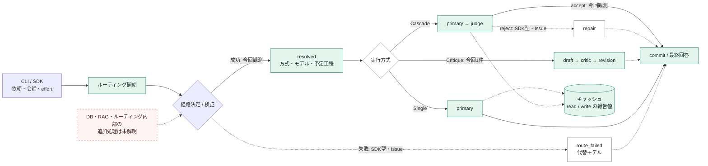
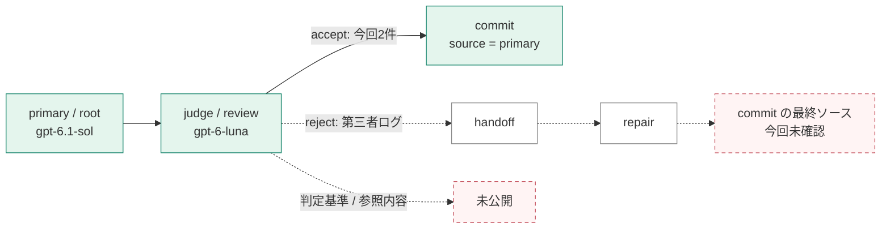
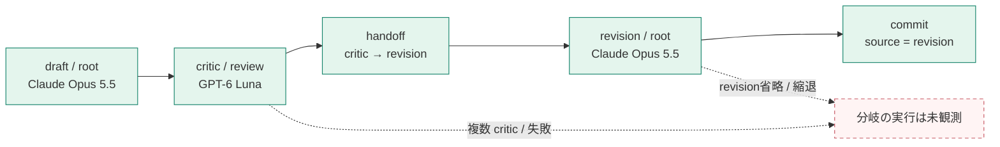
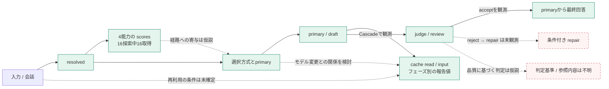

# Copilot Fusion の実行経路：公開仕様・実測・未解明

2026-11-26 時点の調査。**これは公開仕様と観測を組み合わせた仮説モデルであり、GitHub 内部の物理構成図ではない。** SDK 2.0.1 のイベントは experimental であり、版・モデル・アカウントによって変わる。図中の「観測」は特定の実行だけを表す。

## 全体像：何を観測できるか



緑は今回イベントで確認、白は公開説明または SDK 型、赤点線は未解明。矢印は論理上の関係であり、ネットワーク境界、内部コンポーネントの配置や順序を断言しない。`commit` は実際に届いたイベント名の一部で、内部の保存先や DB の存在を示さない。Critique は今回1件の draft → critic → revision を観測した。複数 critic、reject / repair、失敗・縮退はこの調査実行では未確認であり、白枠は実行した証拠ではない。

## 実験条件と結果

事前の問いと対照は [プロトコル](../experiments/fusion-runtime-protocol.md)。[SDK 実験データ](../experiments/data/fusion-runtime-study-2026-11-26.json)、[追試](../experiments/data/fusion-runtime-followup-2026-11-26.json)、[CLI の別実行](../experiments/data/fusion-cli-runtime-2026-11-26.json) は合成テキストだけを用い、実 ID・回答本文・中間出力を保存していない。SDK 実験は新規セッションと3ターン継続、ツール無効。SDK 11ターンで報告された利用量は計 46.6923317 AI credits、別の CLI 1ターンは 0.03025225 AI credits（請求額ではない）。cache / input は `session.fusion_completed` の報告値で、キャッシュの実装単位や料金そのものではない。

| SDK High・同じ長い接頭辞 | 1組目：cache read / input | 追試：cache read / input | 観測方式 |
|---|---:|---:|---|
| 同一会話の初回 | 0 / 10,846 | 1,271 / 10,847 | Single / gpt-6.1-terra |
| 同一会話の2ターン目、依頼も同一 | 10,843 / 18,541 | 10,844 / 18,622 | Single / gpt-6.1-terra |
| 同一会話の3ターン目、末尾の課題を変更 | 0 / 35,823 | 1,271 / 35,932 | Cascade / primary gpt-6.1-sol、judge gpt-6-luna |
| 別の新規セッション、初回の依頼と同一 | 1,271 / 10,848 | 1,271 / 10,843 | Single / gpt-6.1-terra |

2ターン目の両回で約1.08万トークンのキャッシュ読み取りが報告された。新規セッションでも 1,271 トークンが読まれたが、何が再利用されたかは分からない。3ターン目は課題・会話履歴・モデル・方式が同時に変わっており、減少をモデル変更だけの結果とは言えない。実行は固定順序であり、独立したキャッシュ消去や負荷の統制もない。**一回限りの観測を普遍的なキャッシュ率としない。**

### Single：1モデルだけで全処理が終わるのか

今回の単純課題では、SDK が `route_started → resolved → primary started → model.call_start → usage → phase_completed → commit_started → fusion_completed` を通知し、turn 集計は `phaseCount=1`・`requestCount=1`、最終ソースは primary だった。ルーティングとコミットという処理はその前後にある。ここでの requestCount は **Fusion の concrete model request の報告値**で、ルーター内部の推論、DB / RAG、サービス間通信の有無を証明しない。

別の CLI 1.0.115 実行の JSON 出力では route、model call、completed を受信し、Single・1 request を報告したが、phase started / completed は出力に含まれなかった。SDK と CLI は別セッションであり、この差は通知経路やバージョンなども違う。ある出力にイベントが無いだけでは、工程そのものが無かったとは言えない。SDK パッケージの `copilotCliVersion` は 1.0.114、CLI 実行は 1.0.115。

### Cascade：judge は何を決め、どの回答が返るのか

2回の3ターン目で `primary → judge` を完了し、judge の verdict はいずれも `accept`、最終ソースは primary だった。予定には条件付き repair があるが、開始イベントはなかった。judge の `conversationScope` は `review` と報告された。**受け入れられた primary が最終ソースになった具体例**であって、常に同じ流れになる保証や judge の評価基準を示すものではない。



[Issue #4825](https://github.com/github/copilot-cli/issues/4825) の投稿者は `reject`、モデル・各工程の cache / credits を含むイベント例を掲載し、OpenTelemetry に出してほしいと要望している。[公開 Discussion](https://github.com/orgs/community/discussions/206492) には judge から repair への `session.fusion_handoff` の利用者ログ例がある。いずれも**第三者の特定バージョンでの報告**であり、今回の reject / repair 再現ではない。handoff には元の依頼や内容が入り得るため、調査用ログの公開時には本文を保存しない。

### Critique：分岐・失敗時はどうなるか

SDK 2.0.1 の型は `draft`、複数の `critic`、`revision`、各フェーズの `verdict` と、失敗時の `reason`・`degradedToPhaseId`、ターンの `degradedReason` を定義する。これはそれらが**表現可能なイベント**だという証拠であり、全ての分岐が常に実行される証拠ではない。同じ複雑な設計課題では Max の1実行は Single、High の1実行は Critique になった。High では draft（Claude Opus 5.5）→ critic（GPT-6 Luna）→ handoff → 条件付き revision（Claude Opus 5.5）が成功し、最終ソースは revision、合計3 requests。critic は `review`、draft / revision は `root` の scope と報告された。同一セッションの durable log から、handoff の source が critic、target が revision であることを確認した（[本文・IDを除いた記録](../experiments/data/fusion-critique-handoff-2026-11-26.json)）。critic の verdict は null で、その判断基準は分からない。revision は予定上 conditional であり必ず実行されるとは限らない。critic 失敗、revision 省略、複数 critic、縮退は未観測。複数 critic の処理と未完了・失敗を区別できることは合成イベントのテストで確認した。effort以外に時刻や非公開条件も異なり、方式の違いの原因は断定できない。



破線は調査対象の分岐であり、その分岐に到達する条件や最終ソースを示すものではない。SDK型の `degradedToPhaseId` と `degradedReason` の定義を手掛かりにしている。

### ルーティング失敗と追加の方式

SDK 型の `FusionPattern` は `single` / `cascade` / `critique` の3値で、`follow_up` は**方式ではなくフェーズ種別**。`session.fusion_route_failed` は失敗理由と代替モデルを報告する。[Issue #5097](https://github.com/github/copilot-cli/issues/5097) の投稿者は、許可モデル集合との不一致でルートが拒否され代替モデルに落ちた事例を報告し、サーバーと runtime のモデル集合の不一致を推測している。この推測は原因の確定ではなく、今回の実行では同じ障害は再現していない。

SDK 型と今回のイベントに第4の方式は見つからなかった。これは将来・別実装・非公開処理に他の方式が無い証明にはならない。予定・通知の抜け、ルーター自体の内部、モデルの裏側は観測範囲外。

## コマンド・調査の入り口

- `copilot help commands` を CLI 1.0.115 で実行し、`/experimental`、`/context`、`/diagnose`、`/env`、`/usage` が表示されることを確認。対話画面で `/experimental` を実行すると実験機能一覧と設定方法が表示された。これは Fusion の隠しルート切替コマンドではない。`/diagnose` は今回実行していない。CLI の出力はバージョン・設定で変わる。
- [Copilot CLI コマンドリファレンス](https://docs.github.com/en/copilot/reference/copilot-cli-reference/cli-command-reference) と [Fusion の公式説明](https://docs.github.com/en/copilot/concepts/models/copilot-fusion) を参照。隠された Fusion 専用 slash コマンドは今回確認できなかった。
- SDK のイベント型: `fusion-demo/node_modules/@microsoft/copilot-sdk/dist/generated/session-events.d.ts`。SDK の型、CLI が JSON に出すイベント、CLI ローカルの durable セッションログは同一の出力契約として扱わない。開始通知など ephemeral なイベントは保存ログから欠け得る。

## 再現と安全な共有

```sh
cd fusion-demo
./node_modules/.bin/tsx src/runtime-study.ts ../experiments/data/NEW-runtime-study.json
cd ..
node experiments/fusion-cli-observe.mjs /path/to/copilot experiments/data/NEW-cli-study.json
```

出力先は新規ファイルのみ。Fusion への実リクエストを行い、利用量が発生する。`RUNTIME_STUDY_FILTER=high-continuation,high-fresh` で条件を絞れる。記録の各 `totalNanoAiu / 1e9` は報告された AI credits であり、請求額ではない。イベント本文や認証情報は出力しないが、別環境で公開する場合は実際のデータを再確認する。

## 追加探索：3つの仮説に照らした暫定モデル

2026-11-26 の [仮説実験と別データでの確認](fusion-hypotheses-2026-11-26.md) は、上の経路図を**検証するための候補**を追加する。緑は今回観測した値・イベント、破線は値の関係を説明する仮説であって内部の構造や因果の確定ではない。



キャッシュ比較は会話履歴・課題・モデル・方式が同時に変わり、判定実験では reject・不合格草案が無かった。したがってスコア→ルーティング、モデル変更→キャッシュ減少、品質→判定の3本の因果矢印は未確定のままとする。
